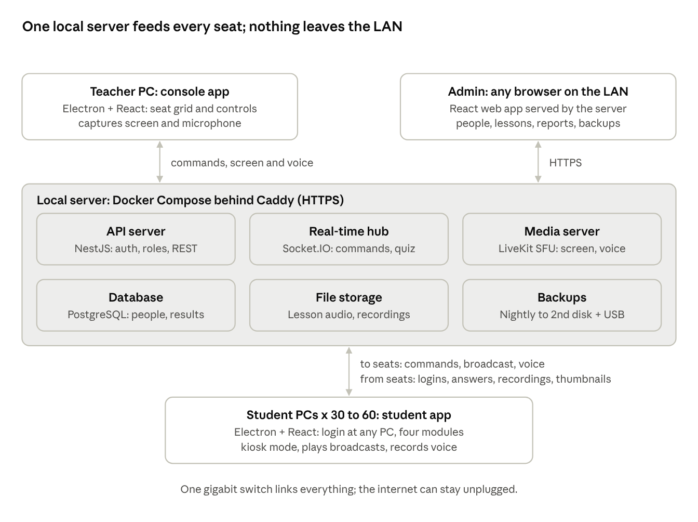
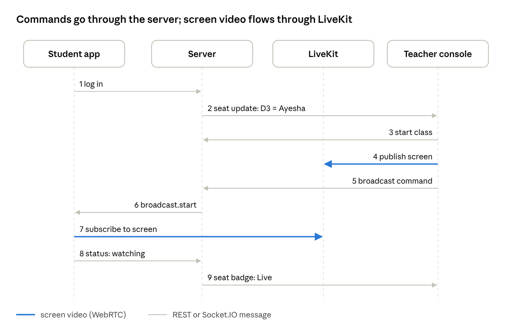
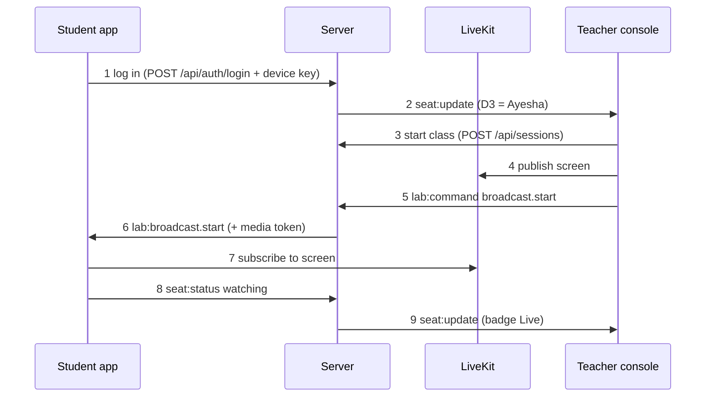

# 2. Architecture

One local server, two desktop apps and a browser-based admin panel, all written in TypeScript, talk to each other over the institute's own network.

## System overview



Three channels carry all traffic: **REST over HTTPS** for data (logins, lessons, results), **Socket.IO** for instant lab commands and live status, and **WebRTC through LiveKit** for screen and voice. The server is the only place data is stored; the apps keep nothing important on the lab PCs, which is why students can sit anywhere.

```
Teacher PC (Electron console) ──┐                 ┌── Admin (any browser)
     commands, screen, voice    │                 │   HTTPS
                                ▼                 ▼
        ┌──────────────── Local server (Docker Compose, behind Caddy HTTPS) ───────────────┐
        │  API server (NestJS)   Real-time hub (Socket.IO)   Media server (LiveKit SFU)    │
        │  Database (PostgreSQL) File storage (/data)        Backups (nightly)             │
        └───────────────────────────────────────────────────────────────────────────────┘
                                ▲
     to seats: commands, broadcast, voice / from seats: logins, answers, recordings, thumbnails
                                ▼
                 Student PCs x 30–60 (Electron student app, kiosk mode)
```

## Technology stack

| Layer                   | Choice                                                                 | Why                                                                                                                                                  |
| ----------------------- | ---------------------------------------------------------------------- | ---------------------------------------------------------------------------------------------------------------------------------------------------- |
| Language                | TypeScript (strict mode) everywhere                                    | One language, shared types between server and apps                                                                                                   |
| Monorepo                | pnpm workspaces + Turborepo                                            | One repository; builds and tests run only where code changed                                                                                         |
| Server framework        | NestJS on Node.js 22 LTS                                               | Clear modules, guards for roles, built-in testing support                                                                                            |
| Database                | PostgreSQL 16 with Prisma ORM                                          | Reliable relational data; typed queries; migrations                                                                                                  |
| Password hashing        | Argon2id via `@node-rs/argon2`                                         | NFR-13 requires Argon2id; the Rust build ships prebuilt binaries, so the lab PCs and CI need no C++ compiler                                         |
| TypeScript scripts      | `tsx` (development only)                                               | Runs workspace TypeScript such as `prisma/seed.ts` while the apps still have no compiled build                                                       |
| Live lab channel        | Socket.IO (NestJS gateway)                                             | Instant commands and status for 60 seats; rooms per lab and per session                                                                              |
| Screen and voice        | LiveKit server (self-hosted SFU) + livekit-client                      | Teacher uploads once, server forwards to every seat; runs offline                                                                                    |
| Teacher console         | Electron + React + Vite + Tailwind + shadcn/ui                         | Silent screen capture (desktopCapturer), native window                                                                                               |
| Student app             | Electron + React (same UI kit)                                         | Kiosk mode, input lock, auto-start, microphone recording                                                                                             |
| Admin panel             | React + Vite web app, served by the server                             | Opens in any browser; nothing to install                                                                                                             |
| White board             | Excalidraw (MIT licence)                                               | Strokes travel as small data messages, not video                                                                                                     |
| State and data fetching | TanStack Query + Zustand                                               | Server data cached; small local state stores                                                                                                         |
| Validation              | Zod schemas in a shared package                                        | The same rules check data on the server and in the apps                                                                                              |
| Reports                 | pdfmake (PDF), SheetJS (Excel), Recharts (charts)                      | Printable and exportable reports                                                                                                                     |
| Fonts                   | IBM Plex via @fontsource, bundled                                      | Work offline                                                                                                                                         |
| Tests                   | Vitest, Testing Library, Supertest, Playwright, socket.io-client       | Supports test-driven development at every level (see 08-testing.md)                                                                                  |
| Packaging               | Docker Compose (server); electron-builder NSIS installers (apps)       | One command to start the server; one-click install on lab PCs                                                                                        |
| Reverse proxy           | Caddy                                                                  | HTTPS on the lab network with a local certificate                                                                                                    |
| Lesson video and PDF    | ffmpeg on the server; HTML5 video player and pdf.js in the student app | Uploaded videos are converted to 720p H.264 MP4 so every lab PC can play them; PDFs open inside the app, offline, with download and print turned off |
| Branding                | Theme tokens loaded from the server's settings                         | Software name, logo and main colour can change later without a new build                                                                             |

**Pinned versions.** These are kept at exact versions, never `^` ranges:

| Piece                | Version    | Where it is pinned                      |
| -------------------- | ---------- | --------------------------------------- |
| LiveKit server       | `v1.13.11` | `infra/docker-compose.yml` (image tag)  |
| `livekit-client`     | `2.23.0`   | each app's `package.json`               |
| `livekit-server-sdk` | `2.19.2`   | the server's `package.json`             |
| `electron`           | `44.9.3`   | `apps/teacher`, `apps/student` packages |
| `@node-rs/argon2`    | `2.2.2`    | the server's `package.json`             |
| `tsx`                | `4.23.15`  | the server's `package.json` (dev only)  |

Upgrade the three LiveKit pieces together, and re-check the broadcast after any bump: a server
older than the client makes the client try the current `/rtc/v1` signalling path, take a 404 and
fall back to the legacy `/rtc` path.

**Electron support window.** Electron keeps only the latest three majors on security fixes, so a
major that is current during the build can fall out of support before launch — Electron 33, used in
the Phase 0 spike, went end of life in April 2025. Electron 44 is supported until March 2027.
Phase 5 therefore has a task to move to the latest supported major before the installers are built.

## Key flows





1. The student logs in at any free PC: `POST /api/auth/login` with student ID, password and the PC's device key. The server returns a token and records the seat.
2. The server tells the teacher console, through the lab room on Socket.IO, that seat D3 now holds Ayesha Khan (`seat:update`).
3. The teacher presses Start class: `POST /api/sessions` opens a session and takes attendance from current logins.
4. When the teacher starts Broadcast PC, the console publishes its screen to the session's LiveKit room.
5. The console sends `lab:command` with `broadcast.start` and the target seats.
6. The server checks the teacher's role and session, then sends `lab:broadcast.start` with a LiveKit token to each target seat.
7. Each student app joins the LiveKit room, shows the teacher's screen full-screen and locks input.
8. Each student app reports `seat:status` = watching.
9. The server forwards it, and the console shows "Live" on those seats.

Every other control (Quiz, Lock, Intercom, Monitor and the rest) follows the same pattern: the command goes through the server, which checks it, and any screen or voice goes through LiveKit.

## Repository structure and conventions

One GitHub repository, `lingualab`, holds everything:

```
lingualab/
├─ apps/
│  ├─ server/        NestJS API, Socket.IO gateway, Prisma, backup jobs
│  │  ├─ src/modules/  auth, users, classes, lab, sessions, lessons, quizzes, grading, reports, backups
│  │  └─ test/         integration and API tests (Supertest)
│  ├─ teacher/       Electron + React teacher console
│  ├─ student/       Electron + React student app
│  └─ admin/         React web admin panel
├─ packages/
│  ├─ shared/        Zod schemas, TypeScript types, event names, constants
│  ├─ ui/            shared React components and design tokens
│  └─ test-utils/    fake lab, seeded database, socket and LiveKit test helpers
├─ e2e/              Playwright end-to-end tests across the apps
├─ infra/            docker-compose.yml, Caddyfile, livekit.yaml, backup scripts
├─ spikes/           Phase 0 throwaway experiments
├─ notes/            demo notes, gate checklists, test reports
└─ docs/             this documentation
```

**Conventions**

- Test-driven: each change starts with a failing test next to the code (`*.spec.ts`) or in `test/` and `e2e/`. Test files are named after the requirement ID they prove (`lab-08.quiz.spec.ts`).
- One NestJS module per area; controllers stay thin, logic lives in services that are unit tested.
- All data crossing the network is checked with a Zod schema from `packages/shared`.
- Socket.IO event names are constants in `packages/shared/events.ts`, never typed by hand.
- ESLint + Prettier, strict TypeScript, no `any`.
- Git: `main` is always releasable; work happens on short branches named after the issue (`feat/LAB-04-broadcast`); a pull request needs green tests to merge.
- Commits follow Conventional Commits (`feat:`, `fix:`, `test:`).

## Network, ports and capacity

The server has a fixed address, for example `192.168.10.2`. Lab PCs find it from the address set at install time, with mDNS (`lingualab.local`) as a fallback.

| Port        | Protocol         | Service                                                     | Open to                   |
| ----------- | ---------------- | ----------------------------------------------------------- | ------------------------- |
| 443         | TCP (HTTPS, WSS) | Caddy: admin panel, REST API, Socket.IO, LiveKit signalling | All lab PCs               |
| 7881        | TCP              | LiveKit media fallback when UDP is blocked                  | All lab PCs               |
| 50000–50200 | UDP              | LiveKit media (screen and voice)                            | All lab PCs               |
| 5353        | UDP              | mDNS discovery                                              | All lab PCs               |
| 5432        | TCP              | PostgreSQL                                                  | Server only (not exposed) |

**Bandwidth for a 60-seat class on a gigabit switch**

| Traffic                                                                | Estimate                                 |
| ---------------------------------------------------------------------- | ---------------------------------------- |
| Broadcast PC, 1080p at 15 fps, about 1.5 Mbps per seat                 | 90 Mbps                                  |
| Monitor thumbnails, 320 px JPEG every 3 s                              | 3 Mbps                                   |
| Voice, about 64 kbps per active stream                                 | Under 5 Mbps                             |
| Lesson audio and files                                                 | Short bursts, served from the local disk |
| Lesson video played to all 60 seats in Demo, 720p at about 2 Mbps each | 120 Mbps                                 |

The busiest case uses under 20% of a gigabit link.

**Second lab later:** add a second gigabit switch linked to the first by a gigabit uplink (or a 10 Gbps uplink if both labs broadcast at once often). The same server handles both labs; each lab is its own Socket.IO room and its own set of LiveKit rooms.
