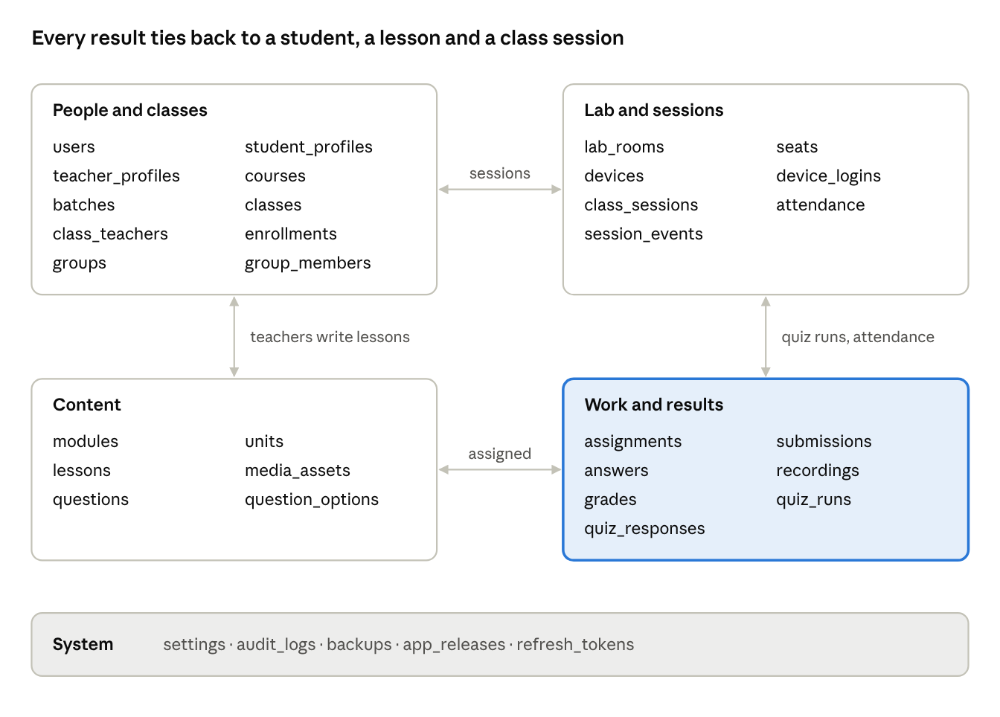

# 3. Database design

PostgreSQL holds every record. Audio, video, PDFs and voice recordings live as files on the server disk, and the database stores their paths.

## Entity relationship overview

Students (in People) link to every table in Work and results through `student_id`, and teachers link to lessons and grades as authors and markers. A student's marks never depend on a PC: the only link between a student and a PC is a row in `device_logins`.

## Table definitions

About 30 tables in six groups. Every table has `id` (UUID, primary key) unless a composite key is shown, plus `created_at` and `updated_at` (timestamptz). FK = foreign key; `?` = nullable. Prisma Migrate creates and versions the schema.

### People

| Table            | Columns                                                                                                                                                                                            | Notes                                                      |
| ---------------- | -------------------------------------------------------------------------------------------------------------------------------------------------------------------------------------------------- | ---------------------------------------------------------- |
| users            | `role` enum(admin, teacher, student), `username` text unique, `password_hash` text, `full_name` text, `phone` text?, `status` enum(active, inactive), `must_change_password` bool, `last_login_at` | Students log in with their student ID as username (S-1001) |
| student_profiles | `user_id` PK/FK users, `roll_no` text, `guardian_name` text?, `guardian_phone` text?, `joined_on` date                                                                                             | One per student                                            |
| teacher_profiles | `user_id` PK/FK users, `subjects` text[]                                                                                                                                                           | One per teacher                                            |
| refresh_tokens   | `user_id` FK, `device_id` FK?, `token_hash` text, `expires_at`, `revoked_at`?                                                                                                                      | Lets the apps stay logged in safely                        |

### Organisation

| Table          | Columns                                                                                                               | Notes                                             |
| -------------- | --------------------------------------------------------------------------------------------------------------------- | ------------------------------------------------- |
| courses        | `name` text, `description` text?                                                                                      | For example Spoken English                        |
| batches        | `course_id` FK, `name` text, `starts_on` date, `ends_on` date?                                                        | For example Fall 2026                             |
| classes        | `batch_id` FK, `code` text unique (B-12), `name` text, `lab_room_id` FK, `schedule` jsonb (days, start time, minutes) |                                                   |
| class_teachers | `class_id` FK, `teacher_id` FK; PK(class_id, teacher_id)                                                              | A class can have more than one teacher            |
| enrollments    | `class_id` FK, `student_id` FK, `status` enum(active, left), `enrolled_on` date; PK(class_id, student_id)             |                                                   |
| groups         | `class_id` FK, `session_id` FK?, `name` text, `kind` enum(pair, random, manual)                                       | Groups with a session_id last only for that class |
| group_members  | `group_id` FK, `student_id` FK; PK(group_id, student_id)                                                              |                                                   |

### Lab and sessions

| Table          | Columns                                                                                                                                                                       | Notes                                                                |
| -------------- | ----------------------------------------------------------------------------------------------------------------------------------------------------------------------------- | -------------------------------------------------------------------- |
| lab_rooms      | `name` text, `rows` int, `seats_per_row` int, `layout` jsonb (pairs, gaps)                                                                                                    | Lab 1 = 5 rows x 6 seats; a second lab is added later as another row |
| seats          | `lab_room_id` FK, `code` text (A1), `row` text, `position` int; unique(lab_room_id, code)                                                                                     |                                                                      |
| devices        | `seat_id` FK unique?, `hostname` text (LAB1-A1), `mac` text unique, `ip` inet, `os_version` text, `app_version` text, `device_key_hash` text, `approved` bool, `last_seen_at` | One per lab PC; the admin approves new PCs                           |
| device_logins  | `device_id` FK, `seat_id` FK, `student_id` FK, `logged_in_at`, `logged_out_at`?, `logout_reason` enum(manual, class_end, idle, admin)?                                        | Who sat where, and when. This is how "no fixed seats" works          |
| class_sessions | `class_id` FK, `lab_room_id` FK, `teacher_id` FK, `started_at`, `ended_at`?, `status` enum(open, closed)                                                                      | One per taught class                                                 |
| attendance     | `session_id` FK, `student_id` FK, `status` enum(present, late, absent), `seat_id` FK?, `first_seen_at`?; PK(session_id, student_id)                                           | Filled from device_logins at Start class and on late logins          |
| session_events | `session_id` FK, `actor_id` FK, `type` text (broadcast.start, lock, quiz.start…), `targets` text[], `payload` jsonb                                                           | Log of every lab command                                             |

### Content

| Table            | Columns                                                                                                                                                                                                                            | Notes                                                                                                                     |
| ---------------- | ---------------------------------------------------------------------------------------------------------------------------------------------------------------------------------------------------------------------------------- | ------------------------------------------------------------------------------------------------------------------------- |
| modules          | `key` enum(speaking, reading, writing, listening) unique, `name` text, `sort_order` int                                                                                                                                            | Four fixed rows, seeded                                                                                                   |
| units            | `module_id` FK, `title` text, `sort_order` int                                                                                                                                                                                     | Optional grouping of lessons                                                                                              |
| lessons          | `module_id` FK, `unit_id` FK?, `kind` enum(lesson, quiz), `title` text, `instructions` text?, `passage` text?, `status` enum(draft, published), `author_id` FK users, `published_at`?                                              | Quizzes in the quiz bank are lessons with kind = quiz                                                                     |
| media_assets     | `lesson_id` FK?, `kind` enum(audio, image, pdf, video), `file_path` text, `mime` text, `size_bytes` bigint, `duration_s` int?, `uploaded_by` FK                                                                                    | Files on disk; the database keeps the path. Videos are converted to 720p H.264 MP4 on upload; PDFs are stored as they are |
| questions        | `lesson_id` FK, `sort_order` int, `type` enum(mcq, true_false, gap, matching, dictation, record, write), `prompt` text, `answer` jsonb (correct value), `max_marks` numeric, `settings` jsonb (play limit, word range, time limit) |                                                                                                                           |
| question_options | `question_id` FK, `sort_order` int, `text` text, `is_correct` bool                                                                                                                                                                 | For multiple choice and matching                                                                                          |

### Work and results

| Table          | Columns                                                                                                                                                                                                                                                | Notes                                                            |
| -------------- | ------------------------------------------------------------------------------------------------------------------------------------------------------------------------------------------------------------------------------------------------------ | ---------------------------------------------------------------- |
| assignments    | `lesson_id` FK, `class_id` FK?, `group_id` FK?, `student_id` FK?, `assigned_by` FK, `due_at`?                                                                                                                                                          | Exactly one of class, group or student is set (check constraint) |
| submissions    | `assignment_id` FK, `student_id` FK, `attempt_no` int, `status` enum(in_progress, submitted, marked), `started_at`, `submitted_at`?, `auto_score` numeric?, `final_score` numeric?, `max_score` numeric; unique(assignment_id, student_id, attempt_no) |                                                                  |
| answers        | `submission_id` FK, `question_id` FK, `response` jsonb, `is_correct` bool?, `score` numeric?                                                                                                                                                           | Auto-marked types fill is_correct and score at once              |
| recordings     | `answer_id` FK, `file_path` text, `duration_s` int                                                                                                                                                                                                     | Speaking answers, WebM/Opus                                      |
| grades         | `submission_id` FK, `teacher_id` FK, `rubric` jsonb (pronunciation, fluency, accuracy, or writing criteria), `score` numeric, `comment` text?, `voice_feedback_path` text?, `marked_at`                                                                | Teacher marking from the grading inbox                           |
| quiz_runs      | `session_id` FK, `lesson_id` FK (kind = quiz), `started_by` FK, `started_at`, `ends_at`, `status` enum(running, closed), `results_shared` bool                                                                                                         | One per quiz launched in class                                   |
| quiz_responses | `quiz_run_id` FK, `student_id` FK, `question_id` FK, `response` jsonb, `is_correct` bool, `answered_at`; PK(quiz_run_id, student_id, question_id)                                                                                                      |                                                                  |

### System

| Table        | Columns                                                                                                                                        | Notes                                                                                        |
| ------------ | ---------------------------------------------------------------------------------------------------------------------------------------------- | -------------------------------------------------------------------------------------------- |
| settings     | `key` text PK, `value` jsonb, `updated_by` FK                                                                                                  | Software name, institute name, logo path, main colour, grading scale, pass mark, backup time |
| audit_logs   | `actor_id` FK?, `action` text, `entity` text, `entity_id` uuid?, `details` jsonb, `ip` inet                                                    | Never edited or deleted from the app; includes every password reset, by admin or teacher     |
| backups      | `kind` enum(automatic, manual, usb), `file_path` text, `size_bytes` bigint, `status` enum(running, done, failed), `started_at`, `finished_at`? |                                                                                              |
| app_releases | `app` enum(student, teacher), `version` text, `file_path` text, `sha256` text, `is_current` bool                                               | Lets lab PCs update from the server                                                          |

## File storage, indexes and retention

**Files on the server disk** (all under `/data`, which is backed up every night):

| Path                                                            | What is stored                                                                                    |
| --------------------------------------------------------------- | ------------------------------------------------------------------------------------------------- |
| `/data/media/lessons/<lesson_id>/`                              | Lesson audio (MP3), video (MP4, converted to 720p), images and PDFs uploaded in the lesson editor |
| `/data/recordings/<yyyy>/<mm>/<submission_id>/<answer_id>.webm` | Student speaking recordings                                                                       |
| `/data/feedback/<grade_id>.webm`                                | Teacher voice feedback                                                                            |
| `/data/whiteboards/<session_id>/<n>.png`                        | White boards saved to a lesson                                                                    |
| `/data/releases/`                                               | Student and teacher app installers for updates                                                    |
| `/data/backups/`                                                | Nightly backups (also copied to the second disk)                                                  |

**Indexes beyond primary and unique keys**

- `enrollments(student_id)`, `class_teachers(teacher_id)`
- `device_logins(device_id) where logged_out_at is null` (who is on a PC now)
- `attendance(student_id)`, `class_sessions(class_id, started_at)`
- `submissions(student_id, status)`, `answers(submission_id)`, `grades(submission_id)`
- `session_events(session_id, created_at)`, `audit_logs(created_at)`

**Retention (proposal, to confirm with the institute)**

| Data                                 | Kept for                                                                        |
| ------------------------------------ | ------------------------------------------------------------------------------- |
| Students, classes, marks, attendance | As long as the institute wants; students who leave are deactivated, not deleted |
| Speaking recordings                  | 1 year, then moved to an archive folder                                         |
| Session events                       | 1 year                                                                          |
| Audit log                            | 2 years                                                                         |
| Nightly backups                      | 14 days on the second disk; weekly USB copies kept by the admin                 |

**Seed data** for a fresh install: one admin account (password changed at first login), the four modules, Lab 1 with 30 seats, and two sample lessons per module.
