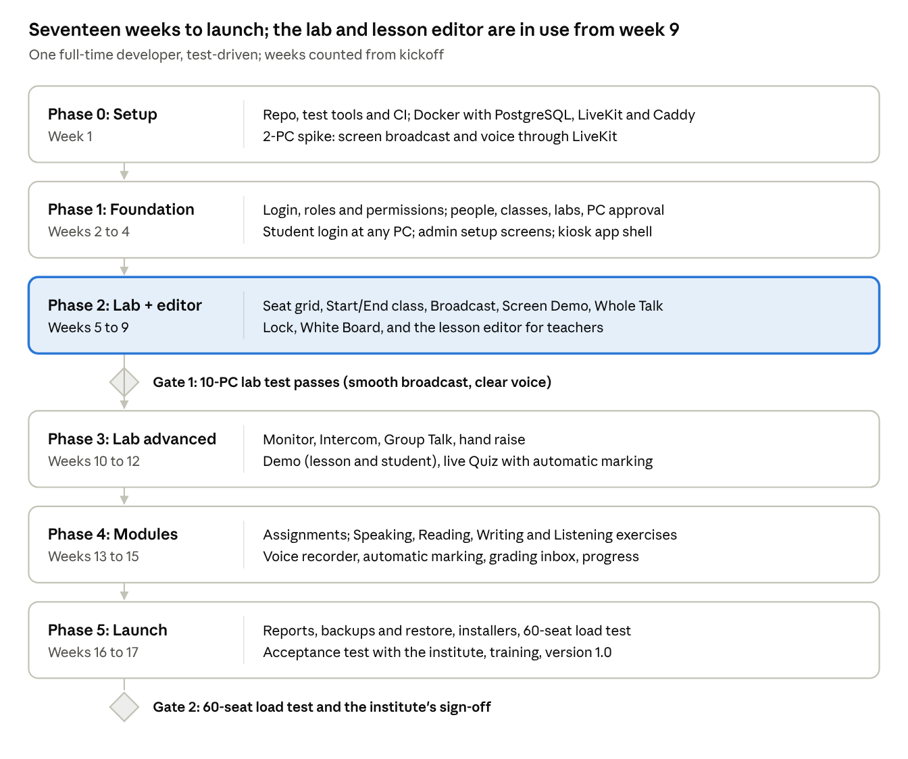

# 9. Project plan

About 17 weeks for one full-time developer, in six phases with two test gates. The lab can be used for teaching after week 9.

## Roadmap

| Phase                       | Weeks          | Focus                                                                                                      |
| --------------------------- | -------------- | ---------------------------------------------------------------------------------------------------------- |
| 0. Setup                    | 1              | Repo, test tools and CI; Docker with PostgreSQL, LiveKit and Caddy; 2-PC broadcast and voice spike         |
| 1. Foundation               | 2–4            | Login, roles and permissions; people, classes, labs, PC approval; student login at any PC; kiosk app shell |
| 2. Lab core + lesson editor | 5–9            | Seat grid, Start/End class, Broadcast, Screen Demo, Whole Talk, Lock, White Board, lesson editor           |
| Gate 1                      | end of week 9  | 10-PC lab test passes (smooth broadcast, clear voice)                                                      |
| 3. Lab advanced             | 10–12          | Monitor, Intercom, Group Talk, hand raise, Demo (lesson and student), live Quiz                            |
| 4. Modules                  | 13–15          | Assignments; four module exercises; recorder; auto-marking; grading inbox; progress; video and PDF viewer  |
| 5. Launch                   | 16–17          | Reports, backups and restore, installers, 60-seat load test, acceptance test, training                     |
| Gate 2                      | end of week 17 | 60-seat load test and the institute's sign-off → version 1.0                                               |

The hardest part, live screen and voice, is proven in week 1, so problems show up before most of the work is done. With two developers (one on the lab, one on the modules) the plan shrinks to about 10–11 weeks.

## Phase-by-phase build plan

Every task below is done test-first: write the failing test (named after the requirement ID), make it pass, then clean up. A phase is finished only when its exit criteria pass.

### Phase 0: Setup and risk check (week 1)

**Goal:** a test-ready repository, and proof that screen and voice work over the institute's network.

- [x] Create the GitHub repository: pnpm workspaces, Turborepo, strict TypeScript, ESLint, Prettier
- [x] Set up test tools: Vitest, Testing Library, Supertest, Playwright, Husky; GitHub Actions running every test on each pull request — Testing Library and Playwright are wired up but exercise nothing yet, because there is no component or screen to test before Phase 1
- [x] Docker Compose with PostgreSQL, LiveKit and Caddy; `/health` endpoint (test first) — four faults found on the first real start, all fixed test-first; see `spike-results.md`
- [x] Spike: teacher Electron app captures its screen and publishes to LiveKit; student Electron app shows it full-screen on 2 PCs — NFR-03 at 204 ms against a 500 ms budget
- [x] Spike: teacher microphone heard clearly in a student headset — voice clear on 2 PCs at 126 ms against a 200 ms budget, but on the laptop microphone and the student PC's **speakers, never a headset**. The headset and the echo check move to Gate 1
- [ ] Confirm the hardware list with the institute

**Deliverables:** repository with green CI; a short video of the 2-PC spike. CI is green; **the video is still outstanding.**

**Exit criteria:** broadcast text readable and voice clear on 2 PCs; CI blocks a pull request with a failing test. **Both met on 2026-10-28.** The second was proved by opening a pull request with a deliberately failing test and watching `main` refuse it: branch protection requires the `check` status with `enforce_admins` on.

### Phase 1: Foundation (weeks 2–4)

**Goal:** the admin can set up people, classes and the lab, and students can log in at any PC.

- [x] Prisma schema and migrations for People, Organisation and Lab tables; seed data — People, Organisation, Lab and sessions plus `settings`; seed gives 1 admin, 2 teachers, 2 classes, 30 students, Lab 1 with 30 seats and the software name "Lab"
- [ ] When the server gets its real build and Docker image: give `packages/shared` a proper `tsc` build and run `pnpm db:seed` from the compiled output inside the container, without `tsx`
- [ ] Login, refresh, logout, change password, account lockout (T-SEC-01)
- [ ] Role guards and the full permissions test (T-ACL-01)
- [ ] Users: create, edit, deactivate, first passwords, Excel import (ADM-01, ADM-02); teachers reset passwords for their own students (ADM-11)
- [ ] Courses, batches, classes, enrolments and groups (ADM-03)
- [ ] Labs (one or more), seat maps, PC registration and approval, device keys (ADM-04)
- [ ] Student login at any PC with device_logins; one login per student (STU-01)
- [ ] Admin panel screens A-01 to A-04 and A-07, matching the prototype
- [ ] Student app shell: auto-start, kiosk mode, login screen, idle logout (STU-06, STU-07)

**Deliverables:** admin panel for setup; student app that logs in.

**Exit criteria:** all Phase 1 tests green; server coverage at least 80%; 30 test accounts log in at random seats on 2 PCs.

### Phase 2: Lab core and lesson editor (weeks 5–9)

**Goal:** teachers can teach with LinguaLab the way they use the old software, and start writing lessons.

- [ ] Socket.IO gateway, rooms, seat updates and re-sync after reconnect (T-LAB-01)
- [ ] Teacher console: seat grid, selection, status bar (LAB-01, LAB-02, LAB-16)
- [ ] Start and End class with attendance (LAB-03)
- [ ] Broadcast PC and Screen Demo (LAB-04, LAB-05)
  - Student apps join the session's LiveKit room at **Start class** and stay connected for the
    whole session. Broadcast then only has to subscribe to the teacher's track, so it starts in
    under 1 s. Joining a room on demand costs about 2 s in ICE and DTLS setup — measured in the
    Phase 0 broadcast spike — which is too slow to do when the teacher presses Broadcast.
  - Put LiveKit signalling behind Caddy: the apps connect to `wss://<server>/livekit` on 443, and
    `infra/Caddyfile` strips the prefix with `handle_path /livekit/*` before forwarding to
    `livekit:7880`. LiveKit's port 7880 is then never opened to the lab, and signalling shares the
    TLS the rest of the API uses. The Caddyfile still uses `handle`, which does not strip the
    prefix, so `/livekit/*` returns a 404 until this is done — found during the Phase 0 Docker
    re-check. Contract in 04-api-and-events.md (Media rooms) and 06-security-and-data.md
    (Transport); test it first, through Caddy, not against port 7880.
- [ ] Whole Talk (part of LAB-09)
- [ ] Lock, unlock, message, launch activity (LAB-13)
- [ ] White Board (LAB-06)
- [ ] Content tables, lesson editor, MP3, MP4 video and PDF upload with video conversion, draft and publish (MOD-05; screens A-05, A-06)
- [ ] Two sample lessons per module, written in the editor

**Deliverables:** version 0.5, used in one real class; teachers writing lessons.

**Exit criteria (Gate 1):** the 10-PC lab test passes: smooth broadcast, clear voice, lock in under 1 second.

### Phase 3: Lab advanced (weeks 10–12)

**Goal:** all eight classroom controls working.

- [ ] Monitor thumbnails and live view, with no icon on the student side (LAB-11); take control if time allows (LAB-12)
- [ ] Intercom, Group Talk, hand raise, mute (LAB-09, LAB-10, LAB-15)
- [ ] Demo: lesson audio and video in sync, and student demo (LAB-07)
- [ ] Quiz bank, live quiz, automatic marking, shared results (LAB-08)
- [ ] Collect files if time allows (LAB-14)
- [ ] Console panels and tabs T-03 to T-07

**Deliverables:** version 0.8 with every control.

**Exit criteria:** all eight controls pass their real-time tests and work on 10 PCs.

### Phase 4: English modules (weeks 13–15)

**Goal:** students learn and are marked in all four modules.

- [ ] Assignments to class, group or student, with due dates (MOD-06)
- [ ] Student dashboard, module pages and exercises for all four modules, plus the video player and PDF viewer (MOD-01 to MOD-04, MOD-10; screens S-02 to S-10)
- [ ] Voice recorder, upload and playback
- [ ] Automatic marking engine for multiple choice, true/false, gap and dictation
- [ ] Grading inbox for speaking and writing (MOD-07; screen T-08)
- [ ] Progress per student and module (MOD-08)

**Deliverables:** version 0.9, feature-complete.

**Exit criteria:** an end-to-end test takes one student through a lesson in each module, marking included.

### Phase 5: Reports, hardening and launch (weeks 16–17)

**Goal:** ready for daily use and signed off by the institute.

- [ ] Reports with PDF and Excel export (ADM-06)
- [ ] Backups, USB copy, restore, and the first restore drill (ADM-08)
- [ ] Settings including branding (name, logo, main colour), audit log, app updates from the server (ADM-07, ADM-09, ADM-10)
- [ ] Move to the latest supported Electron major before building the installers
- [ ] Windows installers, the offline server bundle, and a dry run of the installation guide
- [ ] 60-seat load test (Gate 2)
- [ ] User acceptance test with the institute; fix every issue found
- [ ] Training: teachers (1 hour), admin (2 hours); print the user guides

**Deliverables:** version 1.0 installed in Lab 1.

**Exit criteria:** the acceptance checklist is signed by the institute.

## Risks and mitigations

| Risk                                                                   | Likelihood | Impact | Mitigation                                                                                                             |
| ---------------------------------------------------------------------- | ---------- | ------ | ---------------------------------------------------------------------------------------------------------------------- |
| Screen broadcast lags on older lab PCs                                 | Medium     | High   | Spike in week 1; test 10 PCs at Gate 1; fall back to 720p or 10 fps for text-only screens                              |
| Voice echo or delay                                                    | Medium     | High   | Headsets only; WebRTC echo cancellation on; test at Gate 1                                                             |
| Windows 10 and 11 behave differently (screen capture, kiosk, firewall) | Medium     | Medium | CI builds on Windows; test bench has one PC of each version                                                            |
| Students bypass the student app                                        | Medium     | Medium | Kiosk mode, admin PIN, standard Windows accounts, auto-start                                                           |
| Server failure stops the lab                                           | Low        | High   | UPS, nightly backups, restore drill each term, spare PC ready                                                          |
| Writing tests first feels slow at the start                            | High       | Low    | It pays back in fewer bugs later; keep unit tests fast (under 30 s); test helpers in `packages/test-utils` from week 1 |
| One developer is a single point of failure                             | Medium     | High   | Clear documentation (this set), small pull requests, weekly demos, everything in GitHub                                |
| Scope grows during the build                                           | High       | Medium | New requests go to a backlog with a priority; only Must items enter version 1 without re-planning                      |
| Teachers find the lesson editor hard                                   | Medium     | Medium | Editor ships in Phase 2 so teachers try it early; fix their feedback before Phase 4                                    |
| Antivirus or firewall blocks the apps                                  | Medium     | Medium | Signed installers; firewall rules added by the installer; ports listed in 07-installation.md                           |
| Large lesson videos fill the disk or slow the network                  | Medium     | Medium | Convert every upload to 720p; limit uploads to 1 GB; disk-space warning on the admin dashboard                         |

## Working method

- **GitHub milestones:** one per phase (Phase 0 to Phase 5).
- **Issues:** one per requirement ID (`LAB-04 Broadcast PC`), labelled must, should or could, with its test IDs from 08-testing.md in the description.
- **Branches and pull requests:** a short branch per issue (`feat/LAB-04-broadcast`). The pull request template asks: Were the tests written first? Do they fail without the change? Is the requirement ID in the test file name? Does the screen match the prototype?
- **Merging:** only with every CI check green; `main` is always releasable.
- **Weekly demo:** every Friday, a 15-minute demo to the institute of what was finished that week, on the test bench.
- **Change requests:** new ideas from the institute go into a backlog with a priority. A change to a Must requirement is written into 01-requirements.md first, with its effect on the timeline.
- **Versions:** 0.5 after Phase 2, 0.8 after Phase 3, 0.9 after Phase 4, 1.0 after acceptance. Each release has release notes.
- **Documentation:** this documentation set is updated in the same pull request as any change it describes.
